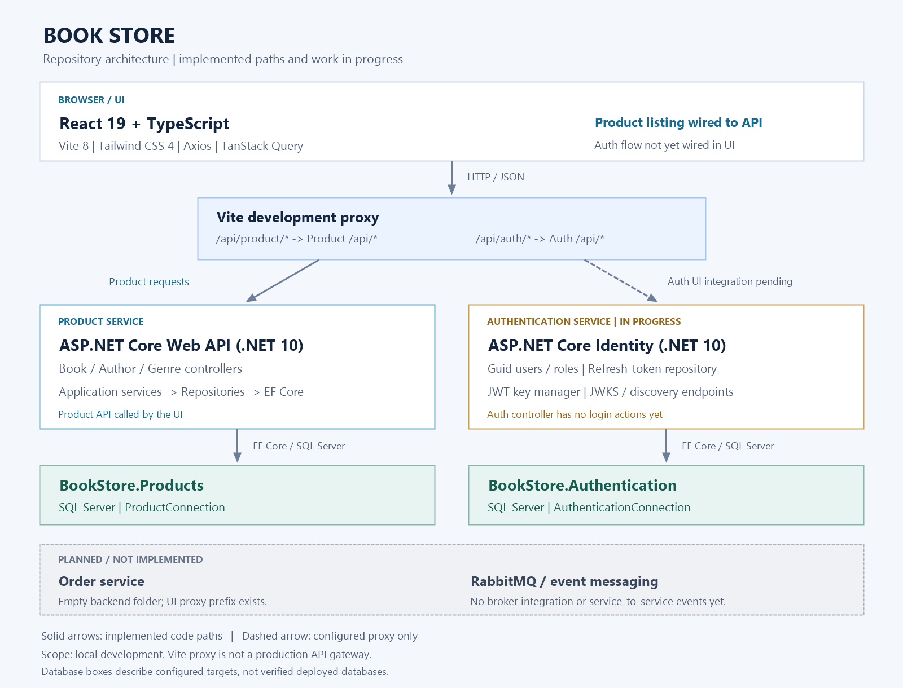

# Book Store

## A study project, the purpose is to learn the structure of a microservice application.

## Architecture



The diagram reflects the current local-development structure:

- The React UI calls the Product API through the Vite development proxy.
- Product and Authentication use EF Core with separate SQL Server databases.
- Authentication is in progress: Identity, refresh-token persistence and
  JWKS/discovery endpoints exist, but login actions and UI integration are not
  implemented yet. Its Vite proxy route is configured.
- Order and RabbitMQ are planned, not implemented. There is no message-broker
  connection between the services.

Solid arrows represent implemented code paths; the dashed arrow represents the
configured Auth proxy, not a working login flow. Database boxes show configured
targets, not deployment status. Vite's proxy is development-only, not a production
API gateway.

To regenerate the PNG on Windows after editing
[the diagram script](resource/generate-architecture.ps1), run from the repository
root:

```powershell
& .\resource\generate-architecture.ps1
```

## Database configuration

When running from the service project folders, both services load the local
`Settings/appsettings.json` file at the repository root. This file is not tracked;
keep credentials out of source control.

Copy the tracked example from the repository root before running the services:

```powershell
Copy-Item Settings\appsettings.example.json Settings\appsettings.json
```

Replace the SQL user/password and Google/Microsoft client ID placeholders with
your local values. Adjust `AllowedOrigins` to match your frontend URL.
`TrustServerCertificate=True` is intended for local development; use a trusted
SQL Server certificate and disable this option in production.

Configure two entries under `ConnectionStrings`:

- `ProductConnection`: SQL Server connection for `BookStore.Products`.
- `AuthenticationConnection`: SQL Server connection for `BookStore.Authentication`.

Use the same server, credentials and connection options when splitting the old
`DefaultConnection`; change only the database name for Authentication. Each
service requires its own non-empty connection string.

To create an Authentication migration from PowerShell at the repository root:

```powershell
Push-Location src\Authentication
dotnet ef migrations add InitDb
Pop-Location
```

Creating a migration does not create the database. After reviewing the generated
migration, run `dotnet ef database update` from the same service folder to apply
it. Use an EF CLI version matching that service's EF Core packages.
