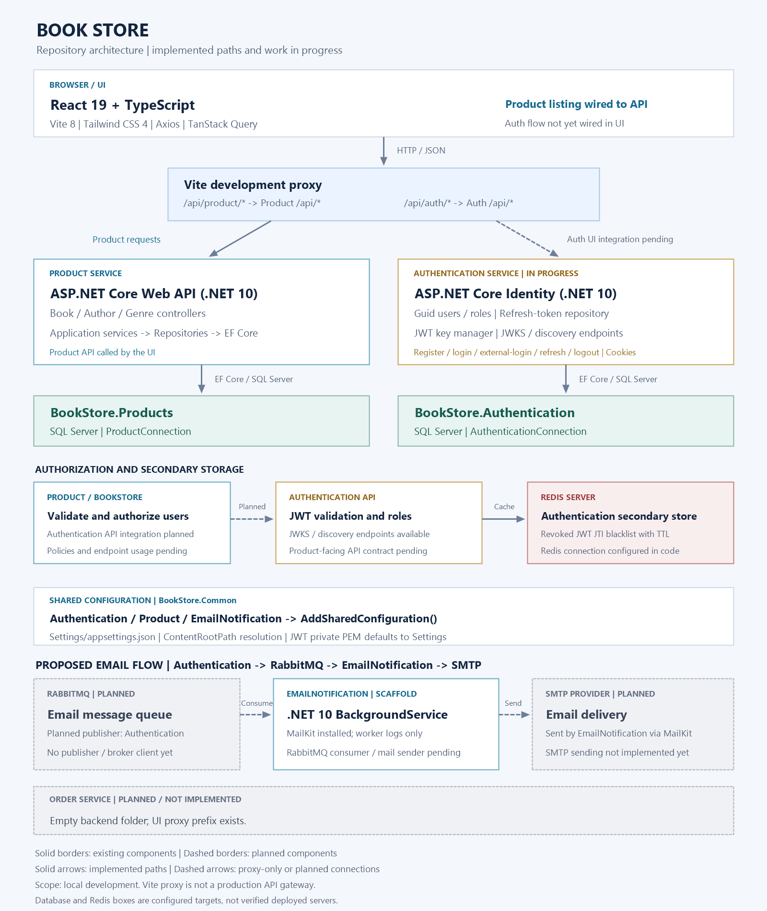

# Book Store

## A study project, the purpose is to learn the structure of a microservice application.

## Architecture



The diagram shows the current local-development request paths:

- The browser reaches the React UI through NGINX over HTTPS on port 8000.
  NGINX forwards `/` to the Vite server on port 5173.
- UI API calls go back through NGINX: `/api/product/` routes to Product on
  port 5187, `/api/auth/` to Authentication on port 5280, and `/api/cart/` to
  Cart on port 5142.
- Product, Authentication, and Cart use separate EF Core SQL Server databases.
- Authentication and Cart share Redis for the revoked-token blacklist and cart
  state. Cart publishes and consumes events through RabbitMQ and syncs cart
  snapshots to SQL Server.

Solid arrows represent configured local application paths. The diagram does
not imply that the local services or external infrastructure are deployed.
Cart validates JWTs using Authentication discovery/JWKS; Product currently has
no JWT authentication middleware configured.

To regenerate the PNG on Windows after editing
[the diagram script](resource/generate-architecture.ps1), run from the repository
root:

```powershell
& .\resource\generate-architecture.ps1
```

## UI API configuration

Copy `src\UI\.env.example` to `src\UI\.env` and set `VITE_API_URL` to the
nginx gateway URL (locally `https://localhost:8000`). API clients use this
shared URL with their service-specific paths.

Set `VITE_GOOGLE_CLIENT_ID` in `src\UI\.env` to the same public client ID as
the backend's `Authentication:Google:ClientId`. Vite embeds this value at build
time, so restart the development server or rebuild the UI after changing it.
Register the UI origin (for example `https://localhost:8000`) in the Google
client's Authorized JavaScript origins.
The Google button uses `@react-oauth/google` to obtain an ID token, then sends it
to `POST /api/auth/external-login`. Password login uses `POST /api/auth/login`.
Both flows use the backend's HttpOnly cookies and log the returned user profile,
not the tokens. Microsoft login and the account-linking UI are not implemented.
The user profile cache is in memory; no `/me` endpoint is currently provided.

The nginx auth location preserves `/api/auth/` when forwarding to port 5280
(unlike the Product location, which rewrites its service prefix). After editing
the gateway configuration, validate and reload nginx.

## Database configuration

When running from the service project folders, both services load the local
`Settings/appsettings.json` file at the repository root. This file is not tracked;
keep credentials out of source control.

Copy the tracked example from the repository root before running the services:

```powershell
Copy-Item Settings\appsettings.example.json Settings\appsettings.json
```

Replace the SQL user/password and Google/Microsoft client ID placeholders with
your local values. Adjust `AllowedOrigins` to match your frontend URL.
`TrustServerCertificate=True` is intended for local development; use a trusted
SQL Server certificate and disable this option in production.

Configure two entries under `ConnectionStrings`:

- `ProductConnection`: SQL Server connection for `BookStore.Products`.
- `AuthenticationConnection`: SQL Server connection for `BookStore.Authentication`.

Use the same server, credentials and connection options when splitting the old
`DefaultConnection`; change only the database name for Authentication. Each
service requires its own non-empty connection string.

To create an Authentication migration from PowerShell at the repository root:

```powershell
Push-Location src\Authentication
dotnet ef migrations add InitDb
Pop-Location
```

Creating a migration does not create the database. After reviewing the generated
migration, run `dotnet ef database update` from the same service folder to apply
it. Use an EF CLI version matching that service's EF Core packages.
